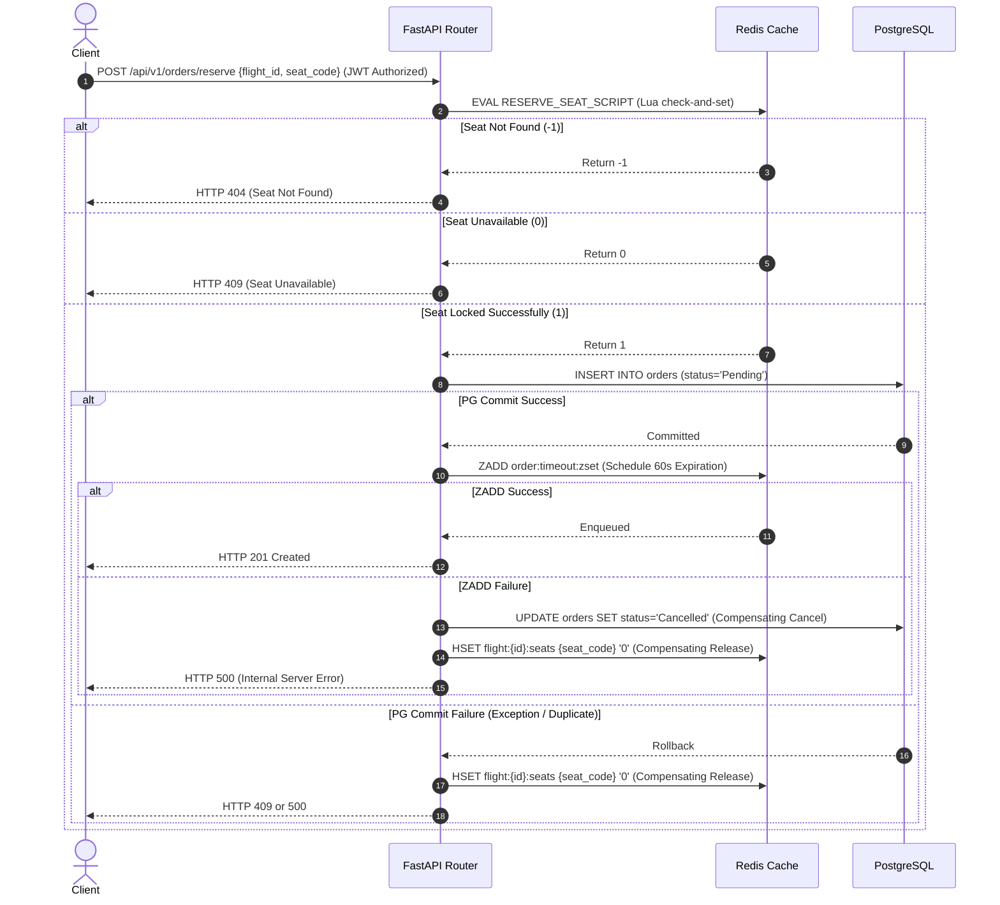
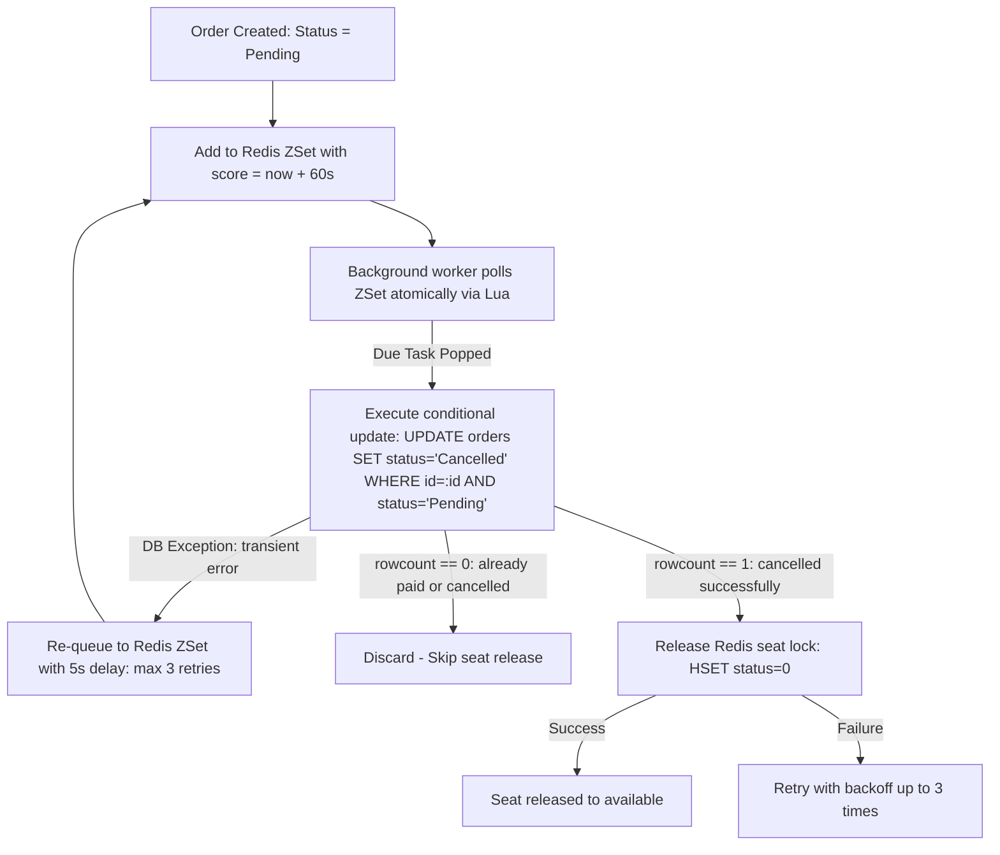

# Flight Booking Backend

[](https://github.com/DEM-YU/flight_backend_project/actions/workflows/ci.yml)

A flight seat reservation backend built with FastAPI, PostgreSQL, and Redis. It models concurrent seat locking, cache-aside queries, and asynchronous order expiration.

---

## Scope

This project models the seat reservation and locking step of flight booking, where each seat is a mutually exclusive resource. Real-world airline reservation systems typically decrement inventory counts per fare bucket (such as Economy Class Y) during initial booking and assign physical seat numbers later during check-in. This project uses discrete seat locking as a simplified model to practice concurrency control and state consistency, and is not a complete ticketing system.

---

## Tech Stack

| Technology | Role |
| :--- | :--- |
| **FastAPI** (0.111.0) | Asynchronous web framework |
| **PostgreSQL 15** & **asyncpg** | Relational database with async driver |
| **SQLAlchemy 2.0** (Async) | Object-relational mapping and schema definitions |
| **Redis 7** & **redis-py** | In-memory store for Lua scripts, caching, and delay queues |
| **PyJWT** & **Bcrypt** | Token authentication and password hashing |
| **pytest** & **pytest-asyncio** | Test suite running against live container instances |
| **Docker Compose** | Local container setup for PostgreSQL and Redis |

---

## Quick Start

### Prerequisites
* Docker and Docker Compose
* Python 3.12+

### 1. Start Database and Redis Containers
```bash
docker compose up -d
```

### 2. Configure Environment Variables
```bash
cp .env.example .env
```

### 3. Install Dependencies
```bash
python3 -m venv venv
source venv/bin/activate
pip install -r requirements.txt
```

### 4. Seed Test Data
Populate the database with a flight, 100 seats, and 1,000 user accounts:
```bash
python seed.py
```

### 5. Start the API Server
```bash
uvicorn main:app --port 8000
# Add --reload during local development if hot-reloading is desired
```
* Interactive API documentation is available at `http://localhost:8000/docs`.

### 6. Run Integration Tests
```bash
pytest -v
```

---

## API Overview

| Method | Path | Auth Required | Description |
| :--- | :--- | :--- | :--- |
| **POST** | `/api/v1/auth/register` | None | Register a new user with email and password |
| **POST** | `/api/v1/auth/login` | None | Authenticate user and return access and refresh tokens |
| **POST** | `/api/v1/auth/refresh` | Refresh Token | Reissue an access token using a valid refresh token |
| **POST** | `/api/v1/auth/logout` | Refresh Token | Invalidate the refresh token in Redis |
| **GET** | `/health` | None | Health check returning database and Redis connection statuses |
| **GET** | `/api/v1/flights` | None | Search flights by departure, arrival, and travel date |
| **GET** | `/api/v1/flights/{flight_id}/seats` | None | Retrieve flight seat map with real-time availability |
| **POST** | `/api/v1/orders/reserve` | JWT Access Token | Atomically reserve a seat and schedule a 60-second expiration |
| **POST** | `/api/v1/orders/{order_id}/pay` | JWT Access Token | Confirm payment for a pending order and mark seat occupied in database |
| **POST** | `/api/v1/orders/{order_id}/cancel` | JWT Access Token | Cancel a pending order, release Redis seat, and remove from timeout queue |

---

## Design Notes

### 1. Seat Locking
Seat availability checks and locking run in Redis via a Lua script that checks whether the seat state is available (`0`) and updates it to locked (`1`) in a single round-trip. This avoids database row lock contention during concurrent reservation requests and rejects conflicting attempts early before reaching PostgreSQL. If the subsequent database insert fails due to network or application errors, a compensating write is sent to Redis to unlock the seat. Similarly, if scheduling the expiration task in the Redis delay queue fails after database insertion, a compensating transaction cancels the database order and unlocks the Redis seat to prevent orphaned pending orders. As an additional safeguard, the orders table enforces a partial unique index on `(flight_id, seat_code)` for active statuses (`Pending`, `Confirmed`) to reject duplicate active bookings if Redis state ever desyncs.



### 2. Payment and Cancellation Race Condition Handling
Order payment and timeout cancellation both execute an atomic conditional update (`UPDATE orders SET status = ... WHERE id = :id AND status = 'Pending'`) and check the affected rowcount. This prevents race conditions where an order is paid and cancelled simultaneously, guaranteeing that only the first operation succeeds. In the timeout cancellation worker, the Redis seat lock is only released if the database update affected exactly one row, preventing a paid seat from being mistakenly reopened. User-initiated cancellation similarly performs a conditional database update, purges the task from the timeout queue, and releases the Redis seat lock with three backoff retries via `release_seat_with_retry`. When a payment succeeds, the seat is confirmed locked in Redis, and the order payload is explicitly removed from the timeout delay queue using `ZREM` so the background worker does not poll it later.

### 3. Timeout Delay Queue
Unpaid orders are scheduled for cancellation by adding their ID, flight ID, and seat code to a Redis Sorted Set (`order:timeout:zset`) with a Unix timestamp score 60 seconds in the future. A background worker periodically polls the queue using a Lua script that executes `ZRANGEBYSCORE` and `ZREM` atomically to retrieve and claim due tasks without duplicate execution across workers. If executing the database cancellation fails due to transient connection errors, the worker re-queues the popped task into the ZSet with a 5-second delay (up to three attempts) to avoid message loss upon pop. If releasing a seat in Redis fails after database cancellation (in either the background timeout worker or user-initiated cancellation), the system retries up to three times with exponential backoff (`release_seat_with_retry`) before logging an error for manual review. This setup avoids maintaining in-memory sleep timers that would be lost on server restart. Because the polling loop runs on a fixed one-second interval, order cancellation has a time resolution of up to one second.



### 4. Query Caching
Flight search queries use a Cache-Aside pattern where route query results are serialized to JSON and stored in Redis with a 30-minute base TTL plus up to 5 minutes of random jitter. Adding jitter prevents large sets of cached flights from expiring at the same moment, avoiding cache avalanche. Empty query results are cached with a short 60-second TTL to avoid repeated database lookups for non-existent routes while still reflecting newly created flights within a minute. Flight seat maps are stored in Redis hashes and loaded from PostgreSQL into Redis on demand when keys are missing. Hydration joins active orders to mark pending reservations locked, and uses an `HSETNX` Lua script to prevent concurrent reservation writes from being overwritten with stale data. However, seat map lookups do not use mutexes, meaning an uncached flight receiving a traffic spike will send concurrent queries to PostgreSQL until the cache is populated.

### 5. Authentication and Rate Limiting
User authentication uses JWT access tokens with a 15-minute expiration and refresh tokens stored in Redis with a 7-day TTL. Logging out deletes the refresh token from Redis, preventing it from generating new access tokens even if the token itself has not reached its cryptographic expiration. The reservation endpoint is protected by a sliding window rate limiter implemented with a Redis Sorted Set, tracking request timestamps per client. The limiter identifies clients by user ID extracted from the JWT token for authenticated requests, and falls back to `request.client.host` for unauthenticated calls. Because it relies on `request.client.host` directly, deploying the service behind a reverse proxy requires configuring proxy headers to extract the real client IP.

---

## Testing

The test suite contains 53 tests: 47 integration tests execute against live PostgreSQL 15 and Redis 7 container instances, and 6 unit tests cover password hashing, JWT encoding/decoding, and client identifier parsing. Database test isolation is maintained by running each test inside an outer transaction with savepoints that roll back on completion, while Redis tests use database 15 and flush keys between runs. The GitHub Actions CI pipeline spins up the same PostgreSQL and Redis service containers and executes all tests automatically on push and pull requests.

### Concurrency Benchmark Results

The following numbers were measured locally against a single Uvicorn worker process running without `--reload` on macOS (Apple M4):

| Mode | Requests | 201 | 409 | 503 | Timeout | P50 (ms) | P99 (ms) |
| :--- | :--- | :--- | :--- | :--- | :--- | :--- | :--- |
| **regular** (50 users, 1 seat) | 50 | 1 | 49 | 0 | 0 | 16.6 | 20.9 |
| **extreme** (1,000 users, 1 seat) | 1,000 | 1 | 999 | 0 | 0 | 367.5 | 402.5 |
| **flash-sale** (1,000 users, 50 seats) | 1,000 | 50 | 950 | 0 | 0 | 771.7 | 891.6 |
| **pool-exhaust** (60 users, 60 seats) | 60 | 60 | 0 | 0 | 0 | 257.2 | 361.3 |
| **breakdown** (3,000 users, 1 seat) | 3,000 | 0 | 686 | 1,000 | 1,314 | 1,489.6 | 1,501.2 |

Each mode was run once on a local development machine; numbers vary between runs due to background system load and event loop scheduling. In single-seat contention tests (`regular` and `extreme`), exactly 1 request succeeded and the remaining requests were rejected at the Redis layer. In the multi-seat test (`flash-sale`), all 50 available seats were reserved and written to PostgreSQL with 0 duplicate orders. Under 3,000 concurrent requests with a 1.5-second client timeout (`breakdown`), event loop queue delays and connection pool limits caused 1,314 timeouts and 1,000 503 errors, showing the throughput boundary of a single worker process.

---

## Known Limitations

1. **Crash Boundaries in Distributed Saga Steps**: If the server process is killed abruptly (e.g. SIGKILL or power outage) after Redis locks a seat but before PostgreSQL commits the order, the seat remains locked in Redis with no corresponding order in PostgreSQL. Similarly, if the process is killed after the database commit succeeds but before the expiration task is enqueued to Redis ZSet, the order remains stuck in `Pending` indefinitely without an automated timeout task. Because application-level compensation rollback only catches runtime exceptions within a live process, an external reconciliation job or periodic background sweep is required to resolve ghost locks and stranded pending orders after hard crashes.
2. **In-Process Background Worker**: The timeout cancellation worker runs as an `asyncio` task within the same process as the web server. While atomic Lua dequeue makes multi-instance polling safe from duplicate processing, the worker cannot be scaled or monitored independently from the API server.
3. **Database Schema Setup**: Tables are created using `Base.metadata.create_all` and a raw SQL statement for the partial unique index during application startup. The project does not currently use database migration tools such as Alembic.
4. **No Protection Against Concurrent Cache Rebuilds on Seat Maps**: Seat map lookups query PostgreSQL directly on cache misses without a mutex or singleflight mechanism. A traffic spike on an uncached flight will send concurrent database queries until the Redis key is populated.
5. **Reverse Proxy Client Identification**: Anonymous rate limiting uses `request.client.host` directly. When deployed behind a reverse proxy or load balancer, middleware is required to read `X-Forwarded-For` to avoid grouping all users under the proxy IP.
6. **Single-Worker Concurrency Limit**: Under 3,000 instant concurrent requests, the single-core Uvicorn event loop and Redis connection pool limits saturated, resulting in 503 errors and client timeouts. Scaling beyond this requires multi-worker deployment (e.g. Gunicorn with Uvicorn workers) and an upstream reverse proxy.
