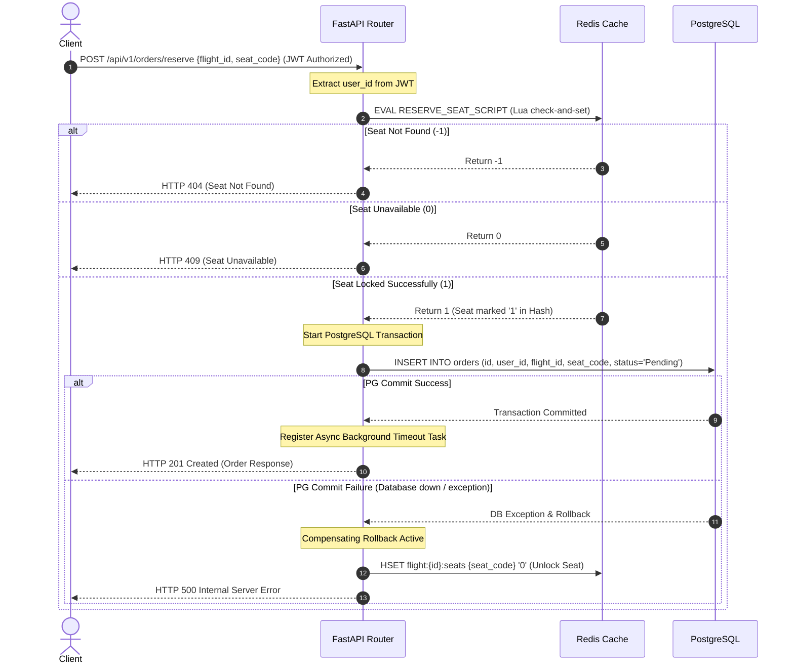
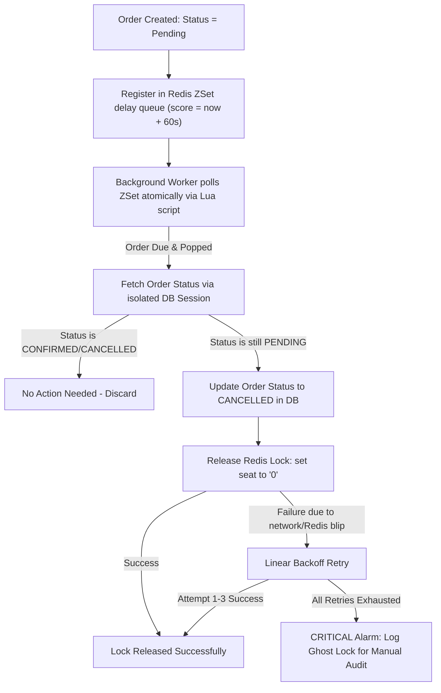

# Flight Booking Backend

A flight search and seat reservation backend built with **FastAPI**, **PostgreSQL**, and **Redis**. Focuses on atomic seat reservations to prevent overselling under concurrent load, cache-aside querying, and JWT authentication with Redis-backed session revocation.

---

## Tech Stack

| Technology | Role |
| :--- | :--- |
| **FastAPI** | Asynchronous web framework (Python 3.12) |
| **PostgreSQL** | Relational database for storing users, flight metadata, and orders |
| **Redis** | In-memory store for atomic seat locks and route cache |
| **SQLAlchemy (Async)** | Async ORM for database operations |
| **PyJWT & Bcrypt** | Password hashing and JWT generation |
| **Docker Compose** | Local container setup for PostgreSQL and Redis |

---

## System Architecture & Workflows

### 1. Atomic Seat Reservation (Lua Lock + PG Transaction)

To prevent overselling under concurrent requests, seat availability checks and locking are decoupled from the database and handled in Redis using a **Lua script**. If the database transaction fails to commit (e.g. connection drops or constraint violations), the backend issues a **compensating write** in Redis to release the seat.



### 2. Redis ZSet Delay Queue for Order Expiration

Unpaid orders expire after **60 seconds**. Rather than relying on in-process sleep tasks that are lost upon server restarts, expiration timestamps are stored in a **Redis Sorted Set (ZSet)** delay queue (`score = unix_timestamp + 60s`). A background worker periodically pops due orders via a Lua script (`ZRANGEBYSCORE` + `ZREM`), cancels unpaid orders in PostgreSQL, and releases the Redis seat lock with linear backoff retries.



---

## Design Decisions & Concurrency Handling

### 1. Atomic Locking via Redis Lua Script
* **Context:** In a high-concurrency booking scenario, database transactions (`SELECT ... FOR UPDATE`) lead to lock contention and connection pool exhaustion. Using separate Redis `GET` and `SET` calls introduces race conditions.
* **Approach:** Check-and-set logic runs in a single Redis Lua script:
  ```lua
  local status = redis.call('HGET', KEYS[1], ARGV[1])
  if status == false then return -1 end       -- Seat does not exist
  if status == '0' then 
      redis.call('HSET', KEYS[1], ARGV[1], '1') -- Lock the seat atomically
      return 1 
  else 
      return 0                                -- Already locked
  end
  ```
  This avoids race conditions and moves lock contention out of PostgreSQL.

### 2. Dual-Write Rollback (Preventing Ghost Locks)
* **Problem:** If a seat is locked in Redis but the subsequent PostgreSQL write fails, the seat remains locked in Redis with no matching order in the database ("ghost lock").
* **Solution:** The database insert is wrapped in a `try...except` block. If the database commit fails, the transaction is rolled back and a compensating `HSET` resets the seat back to available (`0`) in Redis.

### 3. Flight Search Caching (Cache-Aside)
* **Cache-Aside:** Flight search queries check Redis first and fall back to PostgreSQL on a cache miss.
* **Cache Stampede Prevention:** To prevent simultaneous cache expiration across popular routes, a random jitter of ±300s (5 minutes) is added to the 30-minute base TTL.
* **Negative Caching:** Routes with no scheduled flights are cached with a short 60-second TTL to avoid repeated database lookups for empty search results.

### 4. JWT Authentication with Refresh Token Revocation
* **Token Pair:** Login issues a short-lived Access Token (15 minutes) and a long-lived Refresh Token (7 days).
* **Revocation via Redis:** Refresh tokens are stored in Redis (`refresh_token:<token>`). Calling `/auth/logout` deletes the key from Redis. During token refresh, the endpoint validates both the JWT signature and its existence in Redis, allowing active revocation before token expiry.

### 5. Sliding-Window Rate Limiting
* Protects `/orders/reserve` against rapid-fire requests using a Redis ZSet sliding-window script.
* Identifies clients by JWT user ID or client IP, returning HTTP 429 with `Retry-After` headers when limits are exceeded.

---

## 📂 Project Directory Structure

Here is a curated directory layout explaining the core logic files:

*   📂 **`flight_backend_project/`**
    *   📄 [main.py](file:///Users/brooks/github/flight_backend_project/main.py): FastAPI application initialization, exception handlers, and lifespan handlers.
    *   📄 [api.py](file:///Users/brooks/github/flight_backend_project/api.py): Flight search and seat reservation routes.
    *   📄 [auth_api.py](file:///Users/brooks/github/flight_backend_project/auth_api.py): User registration, login, logout, and token refresh endpoints.
    *   📄 [services.py](file:///Users/brooks/github/flight_backend_project/services.py): Central core service layer (Lua scripts execution, Cache-aside logic, compensating rollback, background timeout cancellation).
    *   📄 [rate_limiter.py](file:///Users/brooks/github/flight_backend_project/rate_limiter.py): Distributed sliding-window rate limiting dependency via Redis ZSet.
    *   📄 [models.py](file:///Users/brooks/github/flight_backend_project/models.py): SQLAlchemy models (users, flights, seats, orders) and Pydantic schemas.
    *   📄 [auth.py](file:///Users/brooks/github/flight_backend_project/auth.py): Password hashing (bcrypt) and JWT encode/decode helper functions.
    *   📄 [database.py](file:///Users/brooks/github/flight_backend_project/database.py): Asynchronous DB engines, session makers, Redis clients, and environment settings.
    *   📄 [seed.py](file:///Users/brooks/github/flight_backend_project/seed.py): Mock database seeder initializing flights and seats for test purposes.
    *   📄 [stress_test.py](file:///Users/brooks/github/flight_backend_project/stress_test.py): Concurrent request simulation verifying zero-overselling.
    *   📂 **`tests/`**
        *   📄 [test_auth.py](file:///Users/brooks/github/flight_backend_project/tests/test_auth.py): Integration tests validating user sign-up, dual-token generation, refresh, and logout.
        *   📄 [test_services.py](file:///Users/brooks/github/flight_backend_project/tests/test_services.py): Unit tests for flight queries, Lua locking mechanism, and timeout cancellations.
        *   📄 [test_rate_limiter.py](file:///Users/brooks/github/flight_backend_project/tests/test_rate_limiter.py): Unit and integration tests for sliding window rate limiting and RFC 6585 headers.

---

## Core API Endpoints

| Method | Endpoint | Description | Auth Required |
| :--- | :--- | :--- | :--- |
| **POST** | `/api/v1/auth/register` | Register a new user account | None |
| **POST** | `/api/v1/auth/login` | Authenticate and return Access + Refresh Token | None |
| **POST** | `/api/v1/auth/logout` | Revoke user session and delete Refresh Token from Redis | **Refresh Token** |
| **POST** | `/api/v1/auth/refresh` | Reissue Access Token using a valid Refresh Token | None |
| **GET** | `/api/v1/flights` | Search flights (Cache-Aside, returns `X-Cache-Status` header) | None |
| **POST** | `/api/v1/orders/reserve` | Reserve seat atomically (Returns order details, schedules timeout) | **JWT Access Token** |
| **POST** | `/api/v1/orders/{order_id}/pay` | Confirm payment for order, update status to Confirmed, and mark seat occupied in DB | **JWT Access Token** |

---

## Local Setup

### Prerequisites
* Docker & Docker Compose
* Python 3.12+

### 1. Start PostgreSQL & Redis
```bash
docker compose up -d
```

### 2. Configure Environment Variables
```bash
cp .env.example .env
```

### 3. Install Python Dependencies
```bash
python3 -m venv venv
source venv/bin/activate
pip install -r requirements.txt
```

### 4. Seed Data & Start the Server
Seed a test flight with 30 seats and start the development server:
```bash
python seed.py
uvicorn main:app --host 0.0.0.0 --port 8080 --reload
```
*   **Interactive API Docs**: `http://localhost:8080/docs`

### 5. Run Tests
```bash
pytest -v
```

---

## 📈 Concurrency & Stress Testing (Benchmark)

To prove that the Lua engine guarantees **zero-overselling** under high concurrent pressure:

1. Running the custom stress test script:
   ```bash
   python stress_test.py
   ```
2. **What this script does:**
   - Registers a test user and logs in to retrieve a JWT Access Token.
   - Spawns **30 concurrent async workers** requesting the exact same seat code (`12A`) on flight `AA100` at the exact same millisecond.
3. **Expected Terminal Output:**
   ```text
   Starting stress test...
   [Worker 1] Status: 201 - Reservation Success (Order Created)
   [Worker 2] Status: 409 - Seat is already reserved or unavailable.
   [Worker 3] Status: 409 - Seat is already reserved or unavailable.
   ...
   [Worker 30] Status: 409 - Seat is already reserved or unavailable.
   
   Summary: 1 success, 29 failed (conflict). Overselling prevented successfully!
   ```
